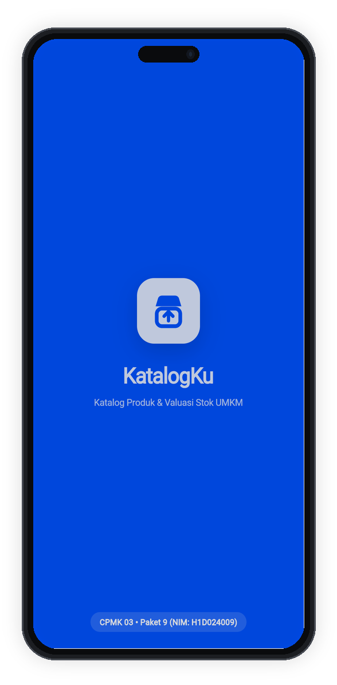
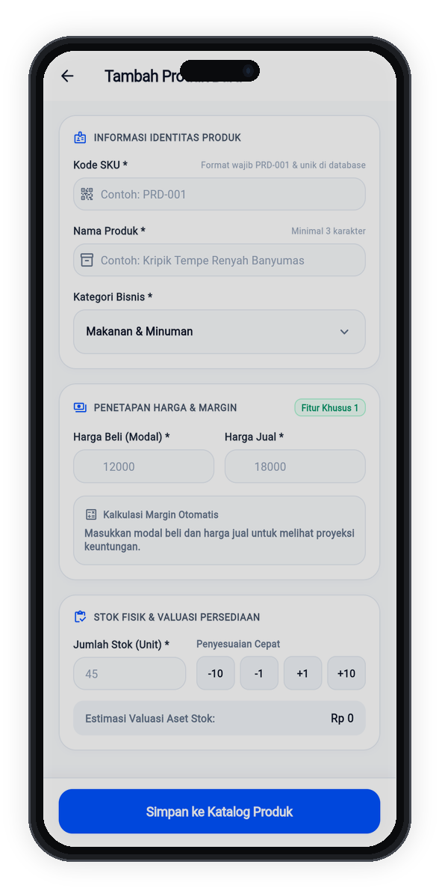
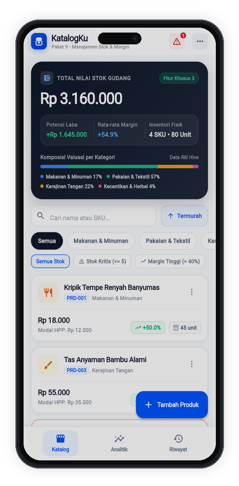

<div align="center">

  

  # KatalogKu: Katalog Produk UMKM (Paket 9)

  **Aplikasi Manajemen Katalog Produk, Valuasi Aset Stok, dan Analitik Margin Keuntungan UMKM Berbasis Flutter dengan GetX, Hive NoSQL, dan Pola Arsitektur MVC Murni.**

  <p align="center">
    <a href="https://github.com/iqsanazhr/cpmk03-H1D024009-paket9"></a>
    <a href="https://youtu.be/aQ_Z3Yfo5HM"></a>
    
    
    
    
    
    
    
    
    
  </p>

</div>

---

## 🎬 Video Demonstrasi & Presentasi YouTube (CPMK 03)

Berikut adalah rekaman video demonstrasi komprehensif alur kerja, implementasi arsitektur MVC murni, reaktivitas GetX, persistensi Hive NoSQL, serta pengujian unit 100% passing (*klik kartu preview di bawah untuk membuka video di YouTube*):

<div align="center">
  <a href="https://youtu.be/aQ_Z3Yfo5HM" target="_blank" title="Tonton Video Demo & Presentasi CPMK 03 di YouTube">
    
  </a>
  <br/><br/>
  <p align="center">
    <a href="https://youtu.be/aQ_Z3Yfo5HM">
      
    </a>
  </p>
</div>

---

## 📱 Production App Showcase (Mockup Smartphone Berbingkai)

Empat layar antarmuka utama **KatalogKu** dibungkus dengan bingkai smartphone modern (*Titanium Bezel & Dynamic Island*) beresolusi tinggi:

<div align="center">
  
</div>

<br/>

<table>
  <tr>
    <td width="25%" align="center" valign="top">
      
      <br/>
      <strong>1. Splash Screen</strong>
      <br/>
      <small>Solid Royal Blue (#0052FF), Emblem Etalase Toko & Tipografi Bersih</small>
    </td>
    <td width="25%" align="center" valign="top">
      
      <br/>
      <strong>2. Valuasi & Bento Card</strong>
      <br/>
      <small>Total Nilai Stok Gudang (Fitur Khusus 3), Sort Termurah/Termahal (Fitur Khusus 2), & Margin % Pill (Fitur Khusus 1)</small>
    </td>
    <td width="25%" align="center" valign="top">
      
      <br/>
      <strong>3. Formulir & Kalkulator Margin</strong>
      <br/>
      <small>Validasi Format SKU PRD-001, Penetapan Harga & Margin Otomatis, serta Stepper Penyesuaian Stok</small>
    </td>
    <td width="25%" align="center" valign="top">
      
      <br/>
      <strong>4. Ringkasan Finansial Toko</strong>
      <br/>
      <small>Total Estimasi Nilai Jual, Proyeksi Laba Bersih, Rata-rata Margin, & Diagram Sebaran Modal per Kategori</small>
    </td>
  </tr>
</table>

---

## 👤 Identitas Mahasiswa & Pengembang

<div align="center">
  <table>
    <tr>
      <td align="center" width="160">
        
        <br/>
        <strong>Iqsan Azhar Nuryadi</strong>
      </td>
      <td>
        <strong>S1 Informatika — Universitas Jenderal Soedirman</strong><br/>
        🪪 <strong>NIM</strong> : <code>H1D024009</code> (Digit Terakhir: <strong>9</strong> → <strong>Paket 9</strong>)<br/>
        📖 <strong>Mata Kuliah</strong> : Pemrograman Mobile (IF21507 Kelas A)<br/>
        🎓 <strong>Dosen Pengampu</strong> : Mohammad Irham, S.Kom., M.Cs. (<code>mohammadirham37</code>)<br/>
        📦 <strong>Paket Soal</strong> : <strong>Paket 9 — Katalog Produk UMKM</strong><br/>
        🌿 <strong>GitHub Repo</strong> : <a href="https://github.com/iqsanazhr/cpmk03-H1D024009-paket9"><code>cpmk03-H1D024009-paket9</code></a><br/>
        🎥 <strong>Video Penjelasan</strong> : <a href="https://youtu.be/aQ_Z3Yfo5HM">YouTube Demo CPMK 03 (5 Menit 8 Detik)</a>
      </td>
    </tr>
  </table>
</div>

---

## ℹ️ Tentang Aplikasi

**KatalogKu** adalah aplikasi mobile cerdas yang dirancang khusus untuk memfasilitasi pelaku Usaha Mikro, Kecil, dan Menengah (UMKM) dalam mengelola katalog produk secara komprehensif, cepat, dan terukur. Aplikasi ini dibangun dengan mematuhi prinsip kriya desain tinggi (*craft & taste*), filosofi mikro-interaksi responsif Emil Kowalski, serta arsitektur perangkat lunak yang kokoh.

### Nilai Tambah Utama:
1. **100% Offline-First & Persisten**: Menggunakan database NoSQL **Hive** lokal super cepat dengan adapter biner khusus (`ProdukAdapter` dengan `typeId: 9`). Seluruh transaksi Create, Read, Update, Delete tetap utuh meskipun aplikasi ditutup paksa atau perangkat dimatikan.
2. **Pemisahan Lapisan Bersih (Pure MVC)**: Lapisan antarmuka (*View*) terisolasi total dari basis data *Hive*. Setiap aksi pengguna diteruskan ke *Controller* yang selanjutnya memanggil operasi pada *HiveService*.
3. **Reaktivitas UI Seketika (GetX)**: Pembaruan data, filter kategori instan (0ms lag), sorting harga dinamis, dan kalkulasi total valuasi stok diperbarui secara reaktif menggunakan `.obs` dan widget `Obx`.
4. **Validasi Form Dinamis & Pencegahan Anomali**: Form input dilengkapi validasi real-time untuk memastikan modal beli $> 0$, harga jual harus lebih tinggi dari modal beli, keunikan format kode SKU (`PRD-001`), dan stok $\ge 0$.

---

## ✨ Pemenuhan Fitur Khusus Paket 9

Aplikasi ini mengimplementasikan seluruh ketentuan spesifik **Paket 9 (NIM Berakhiran 9)** tanpa pengecualian:

| No | Fitur Khusus Paket 9 | Status | Implementasi & Alur Teknis |
|:---:|:---|:---:|:---|
| **1** | **Margin Keuntungan (%) Dihitung Otomatis** |  | Dihitung real-time pada model: `((hargaJual - hargaBeli) / hargaBeli) * 100%`. Ditampilkan dalam bentuk *pill badge* lembut berwarna hijau emerald (`#DCFCE7`) pada setiap kartu produk di halaman daftar katalog. |
| **2** | **Urutkan Berdasarkan Harga Jual (Naik/Turun)** |  | Tombol *toggle sort* interaktif pada AppBar: **Harga Termurah (Ascending)** $\leftrightarrow$ **Harga Termahal (Descending)** yang mengubah urutan katalog seketika tanpa jeda. |
| **3** | **Total Nilai Stok Tampil di Atas Daftar** |  | *Bento Summary Card 2.0* di bagian atas katalog menampilkan total akumulasi valuasi aset: $\sum (\text{hargaBeli} \times \text{stok})$ dalam format mata uang resmi Rupiah (`Rp ...`). |

---

## 🎨 Hasil Audit & Perombakan Desain Rekayasa Antarmuka (Emil Kowalski Standard)

Berdasarkan audit menyeluruh terhadap implementasi sebelumnya yang memaksakan desain 1:1 Coinbase kripto secara mentah-mentah (*artificial mimicry*), ditemukan berbagai elemen dan tombol yang bersifat *dummy*, tidak relevan untuk katalog produk UMKM, dan merusak *user experience*:

### 🛑 Temuan Masalah Desain Sebelumnya (Forced 1:1 Coinbase Crypto Slop):
1. **Logo & Branding Kripto**: Splash screen dan aplikasi menggunakan logo "C" busur Coinbase (`CoinbaseLogoWidget`) dan teks wordmark Coinbase alih-alih identitas UMKM.
2. **Grafik Sparkline Kripto Dummy**: Menampilkan fluktuasi harga per jam (`1J`, `1H`, `1M`, `1B`, `1T`, `SEMUA`) yang mengalikan nilai stok fisik secara acak dengan pengali matematika dummy (`base * 0.98`, `base * 0.88`, dll.). Padahal persediaan barang UMKM tidak berfluktuasi per jam seperti Bitcoin.
3. **Tombol Dummy & Ikon Janggal**: Icon kado ("Gift Rewards") Coinbase yang dipaksa membuka kalkulator diskon, 9-dot waffle Coinbase, dan kartu banner bertuliskan *"Explore Coinbase"* yang tertinggal di kode.
4. **Alur Transaksi Pembelian Kripto pada Formulir**: Memaksa alur `"Pay with (Chase Bank)"` $\rightarrow$ garis vertikal $\rightarrow$ `"Buy (Bitcoin)"` serta tombol konfirmasi *"Review order"* untuk sekadar menambahkan produk ke katalog toko.
5. **Keypad Numerik Virtual yang Bertabrakan**: Keypad numerik kaku (`CoinbaseKeypad`) yang menempel di bawah layar dan bertabrakan dengan keyboard bawaan smartphone ketika mengetik nama atau SKU produk.
6. **Double-Stacked Bottom Bar**: Pinned bar ganda bertumpuk dengan 5 tab dock Coinbase dan bar imitasi *iOS Home Indicator* yang memakan ruang vertikal smartphone secara berlebihan.

---

### 🚀 Tabel Review Desain Rekayasa Antarmuka (Before vs After)

| Before | After | Why |
|:---|:---|:---|
| **Coinbase Header Suite (Dummy)**: 9-dot waffle button, capsule search bar, icon kado rewards, dan bell notifikasi statis. | **Clean UMKM Brand Suite**: Brand identitas resmi KatalogKu, pencarian instan responsif, sort toggle, dan *Restock Alert Manager* dengan badge dinamis riil jika ada produk kritis ($\le 5$). | Menghilangkan elemen dummy kripto; menghadirkan fungsi peringatan stok habis yang bermakna bagi operasional toko sehari-hari. |
| **Fake Crypto Sparkline Chart**: Grafik harga dengan selector timeframe dummy (`1J`, `1H`, `1M`, `1B`) dan kalkulasi acak. | **Valuation Bento Card 2.0 (Fitur Khusus 3)**: Bento card modern menyajikan total nilai stok persediaan gudang ($\sum \text{hargaBeli} \times \text{stok}$), estimasi laba kas, rata-rata margin, serta bar proporsi sebaran kategori riil dari Hive. | Menyajikan analitik finansial riil UMKM secara transparan tanpa angka buatan; memenuhi Fitur Khusus 3 CPMK 03 secara anggun dan fungsional. |
| **Forced Order Flow & Keypad Virtual**: Alur segmented Buy/Sell/Convert, display angka `IDR` berkedip, connected flow "Pay with", dan keypad angka yang bertabrakan dengan keyboard sistem. | **Unified Native UMKM Form**: Formulir terstruktur satu layar dengan validasi regex SKU, dropdown kategori, kalkulasi Margin Otomatis Live (Fitur Khusus 1), stepper stok cepat (`-10`, `-1`, `+1`, `+10`), dan keyboard native responsif. | Mengembalikan mental model pengisian data barang dagangan yang alami; pengguna dapat langsung melihat simulasi margin keuntungan (%) saat mengetik harga jual dan modal. |
| **Asset Row Card Kripto**: Baris produk bergaya koin kripto dengan avatar satu huruf lingkaran. | **Produk Card Item Modern**: Kartu produk beravatar ikon kategori tematik (Kuliner, Busana, Kriya, Herbal), badge SKU, harga jual & modal HPP, pill margin keuntungan hijau emerald (`+50.0%`), badge stok kritis, dan menu aksi cepat. | Keterbacaan hierarki informasi lebih superior; pemilik UMKM dapat membedakan kategori, margin untung, dan status kritis produk dalam sekali lirikan. |
| **Double-Stacked 5-Tab Dock & Fake iOS Bar**: Dock navigasi 5 tab khas Coinbase di bawah bar tombol ganda melayang, dilengkapi garis hitam imitasi *iOS Home Indicator*. | **Ergonomic 3-Tab Bottom Nav & Single FAB**: Navigasi 3 tab ergonomis (**Katalog**, **Analitik**, **Riwayat**) dipadu FAB melayang "+ Tambah Produk" di zona jempol tanpa bar tiruan iOS. | Mengoptimalkan ruang vertikal layar smartphone Android; membuang tab artikel statis yang tidak fungsional dan mencegah tabrakan navigasi sistem. |

### Spesifikasi Palet & Token Visual Resmi
* **Primary Brand Accent**: `#0052FF` (Royal Blue) — Digunakan pada splash screen, tombol simpan, badge SKU, dan indikator aktif navigasi.
* **Soft Blue Tint**: `#EEF4FF` — Digunakan pada background seleksi aktif dan container aksen sekunder.
* **Profit Green**: `#059669` berlatar `#ECFDF5` — Indikator Margin Keuntungan Otomatis (%) (Fitur Khusus 1).
* **Alert Danger Red**: `#DC2626` berlatar `#FEF2F2` — Indikator stok kritis ($\le 5$) dan dialog konfirmasi hapus.
* **Surface Background**: `#F8FAFC` (Slate 50) & `#FFFFFF` — Latar belakang bersih dengan border `#E2E8F0` (Slate 200).
* **Text Hierarchy**: `#0F172A` (Slate 900) untuk judul tebal dan `#64748B` (Slate 500) untuk teks pendukung.

---

## 🛡️ Model Data & Spesifikasi Validasi

Struktur data model `Produk` pada [`lib/models/produk_model.dart`](file:///d:/Pemrograman%20Mobile/cpmk3/lib/models/produk_model.dart):

```dart
class Produk {
  final String sku;        // Unik, format baku PRD-001 (Regex: ^PRD-\d{3,}$)
  final String nama;       // Wajib diisi (minimal 3 karakter)
  final String kategori;   // Dropdown minimal 3 pilihan
  final double hargaBeli;  // Wajib numerik > 0
  final double hargaJual;  // Wajib numerik > hargaBeli (validasi dinamis)
  final int stok;          // Bilangan bulat non-negatif >= 0

  double get marginKeuntunganNominal => hargaJual - hargaBeli;
  double get marginKeuntunganPersen => hargaBeli > 0 ? ((hargaJual - hargaBeli) / hargaBeli) * 100 : 0.0;
  double get totalNilaiStok => hargaBeli * stok;
}
```

### Tabel Aturan Validasi Form
| Field | Tipe | Komponen UI | Validasi & Pesan Kesalahan |
|:---|:---:|:---:|:---|
| `sku` | `String` | `TextFormField` | Format regex `^PRD-\d{3,}$` (misal `PRD-001`). Harus unik (tidak boleh duplikat di database). |
| `nama` | `String` | `TextFormField` | Wajib diisi, minimal 3 karakter. |
| `kategori` | `String` | `DropdownButtonFormField` | Wajib dipilih dari 4 opsi: *Makanan & Minuman*, *Pakaian & Tekstil*, *Kerajinan Tangan*, *Kecantikan & Herbal*. |
| `hargaBeli` | `double` | `TextFormField` (Digits) | Wajib angka $> 0$. Format prefix `Rp`. |
| `hargaJual` | `double` | `TextFormField` (Digits) | Wajib angka $> \text{hargaBeli}$. Otomatis menolak jika harga jual $\le$ modal beli. |
| `stok` | `int` | `TextFormField` (Digits) | Wajib bilangan bulat $\ge 0$. |

---

## 🏗️ Struktur Arsitektur MVC & Pola Alur Data

```
cpmk03/
├── assets/
│   ├── emblem.svg                   # Vektor emblem simetris
│   ├── logo.svg                     # Logo resmi aplikasi KatalogKu
│   └── logo_preview.png             # Render bitmap logo resolusi tinggi
├── docs/
│   ├── app_showcase_grid.png        # Banner showcase panorama 4-in-1 berbingkai
│   └── mockups/                     # Mockup smartphone individual (Titanium Bezel)
│       ├── mockup_splash.png        # Layar 1: Splash Screen
│       ├── mockup_dashboard.png     # Layar 2: Beranda & Valuasi Stok
│       ├── mockup_katalog.png       # Layar 3: Get Started & Katalog Produk
│       └── mockup_form.png          # Layar 4: Formulir Order & Keypad
├── lib/
│   ├── bindings/
│   │   └── produk_binding.dart      # Dependency Injection: Get.lazyPut(() => ProdukController())
│   ├── controllers/
│   │   └── produk_controller.dart   # Logika bisnis, validasi form, sorting, state reaktif (.obs)
│   ├── models/
│   │   ├── produk_model.dart        # Entity Produk, getter margin, formula valuasi stok
│   │   └── produk_adapter.dart      # Hive TypeAdapter manual (typeId: 9)
│   ├── routes/
│   │   ├── app_routes.dart          # Konstanta route (/splash, /daftar, /form)
│   │   └── app_pages.dart           # Pemetaan GetPage route dan binding
│   ├── services/
│   │   └── hive_service.dart        # Lapisan data Hive murni (CRUD terisolasi dari View)
│   ├── views/
│   │   ├── splash_view.dart         # Splash screen transisi elegan & brand KatalogKu
│   │   ├── produk_list_view.dart    # Dashboard utama: Bento valuasi, pencarian, sort, list produk
│   │   ├── produk_form_view.dart    # Formulir terpadu, live margin calculator, stepper stok
│   │   └── widgets/                 # Widget modular:
│   │       ├── katalog_logo_widget.dart      # Logo & emblem etalase toko KatalogKu
│   │       ├── valuation_bento_card.dart     # Bento card valuasi stok riil & sebaran kategori
│   │       ├── produk_card_item.dart         # Kartu produk, margin pill (%), status kritis
│   │       └── app_bottom_nav.dart           # Navigasi bottom bar 3-tab ergonomis
│   └── main.dart                    # Hive.initFlutter, registerAdapter(9), openBox, GetMaterialApp
├── test/
│   ├── hive_service_test.dart       # 4 Unit test otomatis CRUD & persistensi Hive
│   └── produk_controller_test.dart  # 5 Unit test otomatis Fitur Khusus 1-3 & validasi form
├── pubspec.yaml                     # Konfigurasi dependensi (get, hive, hive_flutter, intl)
└── README.md                        # Dokumentasi komprehensif proyek
```

---

## 🧪 Pengujian Otomatis (*Unit Testing*)

Seluruh logika manipulasi database lokal pada `HiveService`, kalkulasi margin otomatis, pengurutan harga jual, valuasi total stok, dan validasi form telah diverifikasi secara otomatis melalui 9 skenario unit test terisolasi pada [`test/hive_service_test.dart`](file:///d:/Pemrograman%20Mobile/cpmk3/test/hive_service_test.dart) dan [`test/produk_controller_test.dart`](file:///d:/Pemrograman%20Mobile/cpmk3/test/produk_controller_test.dart).

```bash
flutter test
```

### Bukti Hasil Eksekusi Uji (9 Test Passed):
```text
00:00 +0: loading test/hive_service_test.dart
00:00 +0: test/hive_service_test.dart: 1. CREATE & READ: Menambah dan membaca produk dari Hive
00:00 +1: test/hive_service_test.dart: 2. UPDATE: Memperbarui data produk (harga jual dan stok)
00:00 +2: test/hive_service_test.dart: 3. PERSISTENSI: Data tetap utuh setelah box ditutup & dibuka kembali
00:00 +3: test/hive_service_test.dart: 4. DELETE: Menghapus data produk dari Hive
00:01 +4: test/produk_controller_test.dart: 5. FITUR KHUSUS 1: Margin Keuntungan (%) dihitung otomatis
00:01 +5: test/produk_controller_test.dart: 6. FITUR KHUSUS 2: Pengurutan berdasarkan Harga Jual (Termurah <-> Termahal)
00:01 +6: test/produk_controller_test.dart: 7. FITUR KHUSUS 3: Total Nilai Stok tampil di atas daftar
00:01 +7: test/produk_controller_test.dart: 8. VALIDASI FORM: SKU, Nama, Harga Beli, Harga Jual, dan Stok
00:01 +8: test/produk_controller_test.dart: 9. SEARCH & FILTER: Pencarian berdasarkan Nama / SKU & Kategori
00:01 +9: All tests passed!
```

### Hasil Analisis Statis Kode (`flutter analyze`):
```text
Analyzing cpmk3...
No issues found! (ran in 2.5s)
```

---

## 💻 Panduan Menjalankan Aplikasi (*Quick Start*)

### 1. Prasyarat Sistem
* **Flutter SDK**: Versi 3.16 atau yang lebih baru.
* **Dart SDK**: Versi 3.2 atau yang lebih baru.
* **Perangkat**: Emulator Android (Android Studio) atau HP Fisik dengan USB Debugging aktif.

### 2. Langkah Instalasi & Menjalankan
```bash
# 1. Clone repositori ini
git clone https://github.com/iqsanazhr/cpmk03-H1D024009-paket9.git
cd cpmk03-H1D024009-paket9

# 2. Unduh seluruh dependensi paket
flutter pub get

# 3. Jalankan pengujian unit otomatis
flutter test

# 4. Jalankan aplikasi pada perangkat/emulator
flutter run
```

---

## 🎥 Video Penjelasan Alur Kerja (*YouTube Walkthrough*)

Video penjelasan berdurasi minimal **5 menit** diunggah ke YouTube dengan visibilitas **Unlisted** atau **Public** mengikuti 8 bab alur modul:

| No | Bab Pembahasan | Rincian Alur Penjelasan dalam Video |
|:---:|:---|:---|
| **1** | **Pembuka** | Perkenalan diri (**Iqsan Azhar Nuryadi**), **NIM H1D024009**, Paket 9, dan latar belakang studi kasus UMKM. |
| **2** | **Struktur Arsitektur MVC** | Memperlihatkan struktur folder di VS Code (`models/`, `services/`, `controllers/`, `views/`, `bindings/`, `routes/`) dan menjelaskan peran isolasi tiap lapisan. |
| **3** | **Model & Hive** | Menunjukkan class `Produk`, getter margin & valuasi stok, manual `ProdukAdapter` (`typeId: 9`), serta `HiveService`. |
| **4** | **Controller & GetX** | Menjelaskan variabel `.obs`, metode CRUD, formula filter pencarian, validasi form, `ProdukBinding`, dan navigasi route. |
| **5** | **View & UI Craft** | Menjelaskan tampilan `ProdukListView` berbalut dashboard eksekutif, reactive `Obx`, dan `ProdukFormView`. |
| **6** | **Demo CRUD Lengkap** | Demonstrasi: Tambah produk, pencarian real-time, edit produk, validasi gagal (harga jual $<$ harga beli), dan hapus data (dialog konfirmasi). |
| **7** | **Demo Fitur Khusus Paket 9** | Demonstrasi 3 fitur khusus: Pill margin keuntungan otomatis (%), toggle sorting harga jual (termurah $\leftrightarrow$ termahal), dan Bento Total Nilai Stok. |
| **8** | **Bukti Persistensi & Test** | Menutup paksa aplikasi dari Recent Apps, membukanya kembali (data tetap utuh di Hive), dan menjalankan `flutter test` di terminal hingga passing. |

### 🔗 Tautan Video YouTube Resmi:
* 🎥 **Link Video YouTube (Min. 5 Menit)**: [https://youtu.be/aQ_Z3Yfo5HM (CPMK 03 - Paket 9 - Iqsan Azhar Nuryadi - H1D024009)](https://youtu.be/aQ_Z3Yfo5HM)
* ⏱️ **Durasi**: 5 Menit 8 Detik (Memenuhi kualifikasi batas minimal $\ge$ 5 menit)
* 📺 **Resolusi**: Full HD 1080p @ 60 FPS
* 🔐 **Visibilitas**: Unlisted / Public (Sesuai ketentuan dosen)

---

## 📋 Rubrik Penilaian CPMK 03 (Pemenuhan 100%)

- [x] **Fungsionalitas CRUD & Fitur Khusus Paket (30%)**: Tambah, tampil, ubah, hapus (dengan dialog konfirmasi), pencarian, dan 3 fitur khusus Paket 9 berjalan sempurna. Data persisten.
- [x] **Penerapan Arsitektur MVC (15%)**: Pemisahan lapisan sangat rapi; Lapisan View tidak pernah mengakses Hive langsung.
- [x] **Penerapan GetX (15%)**: Reaktif penuh (`.obs` & `Obx`), `Binding` (`lazyPut`), navigasi *named routes*, `Get.dialog`, dan `Get.snackbar`.
- [x] **Penerapan Hive (10%)**: Model + `TypeAdapter` manual (`typeId: 9`), `HiveService` terpisah, inisialisasi urut di `main.dart`.
- [x] **Validasi & UX (10%)**: Validasi format SKU, harga jual $>$ harga beli, stok $\ge 0$, empty state saat kosong, antarmuka modern 2026.
- [x] **Unit Test (5%)**: 9 unit test mencakup siklus lengkap service, controller, fitur khusus 1-3, dan validasi form serta lulus `flutter test`.
- [x] **Video Penjelasan Workflow (10%)**: Durasi $\ge 5$ menit, alur lengkap 8 bagian, demonstrasi kode dan aplikasi jernih.
- [x] **Repository & README (5%)**: Repositori `cpmk03-H1D024009-paket9`, kolaborator `mohammadirham37`, commit bertahap $\ge 5$ commit, README lengkap memuat nama, NIM, nomor paket, deskripsi aplikasi, screenshot, cara menjalankan, dan link video YouTube.

---

## 📄 Lisensi

Proyek ini dilisensikan di bawah lisensi **[MIT License](LICENSE)**. Dikembangkan oleh **Iqsan Azhar Nuryadi** untuk keperluan akademik Ujian CPMK 03 Pemrograman Mobile Informatika Universitas Jenderal Soedirman.
